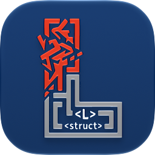

# Legibyl

Legibyl checks PDFs for accessibility (PDF/UA-1 and PDF/UA-2, and WCAG 2.2's
machine-checkable rules, contrast among them) and helps fix them:
a desktop app (Avalonia, on Windows, Linux and Apple-silicon Macs), and a command-line tool
for scripts and AI agents. It explains each failure in plain language, fixes
what it safely can, lets you check and edit the tags a screen reader uses (alt
text, headings, link descriptions), and tags untagged PDFs from what their pages
look like. Checking is done by the real [veraPDF](https://verapdf.org/)
validator, embedded via [IKVM.NET](https://ikvm.org/): no Java to install, and no
separate process.

## Using the app

1. **Open a PDF**: **Browse…**, drop it on the window, or **File › Open…**. Each
   PDF opens in a window of its own, and is checked as it opens; **Check Again**
   checks it again after it's changed on disk (re-exported from the tool that
   made it, say).
2. **Read what's found.** Failures (red) are what PDF/UA requires; warnings
   (orange) are worth a look. Each says **What it means** and, where there's no
   auto fix for it, **What to do**. A wrench marks what has an auto fix; a wand,
   what tagging from the suggested structure fixes.
3. **Structure…** shows the tags a screen reader uses. Check the headings, the
   figures' alt text and the reading order, and edit them there. A PDF with no
   tags gets **Suggest Structure…** instead, to check and edit what a layout
   detector suggests.
4. **Auto Fixes…** chooses fixes, like the document's language and title.
5. **Export…** writes a fixed copy and opens it beside the original, to check
   again. The PDF you opened is never changed. **File › Save** keeps your review
   (edits, dismissed warnings, chosen fixes) next to it, to pick up later.

Automated checks can't judge everything: whether alt text says what a figure is
for, heading levels, reading order and table headers still need a person.

**About Legibyl** (in the application menu on macOS, **Help** elsewhere, and under
the steps in an empty window) says which version this is, the veraPDF it bundles
and the versions of what else it's built on (all read from the build, as
`legibyl --version` is), its license, with **Licenses…** showing `licenses/`'s
texts, links to the project, and where its own files are. **Copy** gives a bug
report the same, starting with `legibyl --version`'s line.

## Using the command line

`legibyl validate`, `legibyl fix`, `legibyl structure`, and `legibyl layout
suggest` / `apply`, with JSON output and exit codes meant for scripts and AI
agents: see [Command-line tool](#command-line-tool-for-scripts--ai-agents).

The rest of this README is the detail, including how it works inside.

### Appending accessible PDFs

**File › Append PDFs…**, or `legibyl append first.pdf second.pdf --output packet.pdf`,
joins passing PDF/UA inputs without running fixes. Each input keeps its tags within
a separate part of the output.

A PDF's tags can be reached two ways: down from the top of its tags, and back
from the page content through its parent tree. A PDF can pass veraPDF while its
parent tree still ties some content to a tag that isn't in its tags any more (one
cut out without its parent-tree entries), or the two otherwise disagree. Joining
copies the tags, so that content would lose its tag. So Append checks both ways,
and refuses such a file before writing anything, saying which content and parent
tree entry disagree; the files, and any existing output, are left as they were.
The CLI reports `status: "refused"` and exits 2; the app shows the same reason.

When it's page content tied to the wrong tag, or to one no longer in the tags,
choose **Rebuild the parent tree** in Auto Fixes… (or `legibyl fix --fixes
parent-tree`) and join the fixed copy: see the parent tree, below. For anything
else, or content that fix keeps, export it again with tags from the tool that
made it, or have the tags fixed in a PDF editor, then check it and join it again.
A tag that's only in the parent tree can't be put back automatically: nothing says
where among its neighbours it was read.

Structure… shows such content on its own, after the tags, under **Tied to tags
that are gone**: each one's page, text, and description, highlighted on the page
where it can be. It's there to look at, not to edit or move: nothing says where
its tag was read, so showing it never puts it back in the tags.

## How it works

veraPDF's `greenfield-apps` fat jar (bundling its Greenfield validation
core) is downloaded from Maven Central on the first build (pinned by version
and SHA-256 in `Directory.Build.props`, cached under `obj/`) and referenced
from the `Legibyl.Validation` project via IKVM's `<IkvmReference>` MSBuild item,
which translates the Java bytecode into a .NET assembly at build time. The
`Legibyl.Validation` project exposes a small, plain .NET API
(`IPdfValidator`, `IPdfFixer` and `IStructureTreeReader`, returning a
`ValidationReport`, a `FixResult` and a `StructureNode`; see `Results.fs` for
their signatures) that fully isolates all Java/IKVM types from the rest of the
app. `IPdfFixer` combines
veraPDF's metadata fixer with a small iText-based structural fix pass for
selected safe object-level fixes, such as setting page `/Tabs /S` when a
page has annotations, describing table-of-contents links from their own
text, naming the document, and removing empty semantic `/P` structure elements.
`IStructureTreeReader` walks veraPDF's PD model's `StructTreeRoot` (the
tagged logical structure tree) directly, independent of running a
validation pass.

Each failed check carries a `locationContext` — a slash-separated walk of
veraPDF's internal object model (e.g.
`root/document[0]/pages[1](9 0 obj PDLinkAnnot)`) pinpointing exactly where
in the document the problem is. `PdfLocationParser` turns this into a page
number and a plain-English breadcrumb (e.g. "Page 2 — Document → Link
annotation"), used by the GUI's results grid (see below) and available on
`RuleViolation.Location`/`PageNumber` for any future consumer. Where the
location pins down something drawn on the page — marked content (`{mcid:N}`),
a structure element, or an annotation — Legibyl also works out its bounding
box (`RuleViolation.Geometry`, in `FindingGeometry.fs`).

veraPDF logs through `java.util.logging`, which IKVM would print to the console.
Legibyl replaces the root logger's console handler with its own
(`ValidatorLog.fs`), so nothing veraPDF logs reaches the console. What it logs at
WARNING and above while validating a file (a font it couldn't read, marked content
nested in marked content) is kept for that validation instead, counted by message,
as `ValidationReport.Notes`: the GUI lists them under the banner ("veraPDF noted 1
thing while reading the file"), the CLI as `validatorNotes`. They're not findings:
no rule, not counted, nothing to dismiss.

## Solution layout

```
Legibyl.slnx
src/
  Legibyl.Validation/   F# facade over the veraPDF Java validation core (IKVM)
  Legibyl.Rendering/    Renders page images with PDFium, with highlight boxes around a failure's region (SkiaSharp)
  Legibyl.Layout/       Suggests structure for untagged pages with a layout detector (PaddleOCR, model downloaded on use)
  Legibyl.Gui/          Avalonia + FuncUI UI (Windows/macOS/Linux): file picker, results grid (checked against the PDF/UA its PDF version calls for)
  Legibyl.Cli/          Command-line tool (legibyl.exe), JSON-first, agent-friendly
tests/
  Legibyl.Validation.Tests/   xUnit v3 + FsUnit tests using real PDF/UA-1 corpus samples
  Legibyl.Gui.Tests/          xUnit v3 + FsUnit tests of the GUI on Avalonia's headless platform
  Legibyl.Cli.Tests/          xUnit v3 + FsUnit tests of the command line: fix names, --fixes and --edits
tools/
  Legibyl.Screenshots/        Dev-only: saves GUI screenshots without a display (headless)
installer/
  Legibyl.Gui.Installer/      WiX v6 MSI installer for the GUI (LegibylSetup.msi)
lib/vendor/verapdf-jars/    veraPDF jar provenance/upgrade README (jar is fetched at build time)
licenses/                   AGPLv3+/GPLv3+/MPLv2+/Apache-2.0/MIT license texts and third-party NOTICE
```

## Building & running

Requires the .NET 10 SDK. The GUI, CLI, and tests build and run on Windows,
macOS, and Linux; only the MSI installer project is Windows-only, so the
solution build skips it (build it explicitly, see below).

```powershell
dotnet build Legibyl.slnx
dotnet run --project src/Legibyl.Gui/Legibyl.Gui.fsproj
```

Package versions are managed centrally in `Directory.Packages.props`, with
transitive pinning: a version listed there also applies when a package only
comes in as another's dependency (used to lift Newtonsoft.Json, from
LanguageDetection, past a known vulnerability). Projects reference packages
without versions. The WiX installer keeps its own, since it only builds on
Windows.

## Testing

```powershell
dotnet test Legibyl.slnx
```

`Legibyl.Validation.Tests` covers validation, fixes, and rendering. It also
checks veraPDF against the PDF Association's labeled PDF/UA-1 technique
samples (see `tests/Legibyl.Validation.Tests/SampleCorpus/README.md`).
`Legibyl.Gui.Tests` opens sample PDFs in the real `MainWindow` on Avalonia's
headless platform (rendered with Skia, no display needed) and checks what's
on screen, e.g. that no results-grid column header is clipped.

## Screenshots

`tools/Legibyl.Screenshots` saves a PNG of the GUI with a PDF open, using the
same headless setup as the GUI tests, so it works over SSH or with the
display asleep. It shares `HeadlessWindow.fs` with `Legibyl.Gui.Tests`.

```powershell
dotnet run --project tools/Legibyl.Screenshots -- <pdf> <out.png> [--theme light|dark] [--select <row>] [--size 1200x720]
```

`--select` picks the results row (0-based) whose details and page preview
are shown; by default it's the first. Screenshots are 1× scale.

## Publishing (self-contained)

```powershell
dotnet publish src/Legibyl.Gui/Legibyl.Gui.fsproj -c Release -r win-x64 --self-contained true -o publish/gui
```

Use `-r win-arm64`, `-r linux-x64`, `-r linux-arm64` or `-r osx-arm64` for the
other platforms Legibyl supports: Windows and Linux (x64 and Arm64), and Macs
with Apple silicon. **Intel Macs (`osx-x64`) aren't supported:** Tesseract's OCR
has no native library for them (and nor has ONNX Runtime, planned for tables in
#224), so the app would be missing parts, and nothing builds or tests it there.

The published output bundles IKVM's translated JRE (`IKVM.Java.dll`), so
the app runs standalone with no external Java installation.

The CLI publishes the same way (`src/Legibyl.Cli/Legibyl.Cli.fsproj`). Published
for a runtime, it's compiled ahead of time (ReadyToRun), except `IKVM.Java.dll`,
so a run starts faster: a cold `validate` of a small PDF takes about 1.85 s
instead of 2.16 s, for a publish of 308 MB instead of 270 MB. Compiling
`IKVM.Java.dll` too would save another ~0.35 s but add 100 MB. The GUI doesn't
need it as much: it gets veraPDF ready in the background as it starts.

## Windows installer (MSI)

`installer/Legibyl.Gui.Installer` builds a WiX v6 MSI (`LegibylSetup.msi`)
that installs the self-contained GUI to `Program Files\Ekon Benefits\Legibyl`,
with Start Menu and Desktop shortcuts, and offers it for PDFs under
right-click › **Open with** (a `Legibyl.pdf` file type listed in `.pdf`'s
`OpenWithProgids`; it never becomes their default app). It publishes the GUI itself as part of
the build (no separate publish step needed):

```powershell
dotnet build installer\Legibyl.Gui.Installer\Legibyl.Gui.Installer.wixproj -c Release
```

For Arm64, add `-p:GuiRuntime=win-arm64` (an Arm64 MSI of the Arm64 build). To
build it from a GUI already published (and signed, as the release workflow does),
add `-p:PublishGui=false -p:GuiPublishDir=<folder>`.

The MSI is written to `artifacts\msi\en-US\LegibylSetup.msi`. Installing
to `Program Files` requires administrator privileges (standard per-machine
MSI behavior). The installer also bundles the `LICENSE`/`licenses/` files
so the license texts and third-party attribution are available on the
installed machine, not just in this source repository.

## Icons

The icon's source is `assets/icon_glass.icon`, made in Apple's Icon Composer.
Its one layer is `assets/icon_vector.svg`, exported from `assets/icon_vector.af`
(Affinity). The app's icons are made from it by Apple's own tools, each size
rendered at that size:

- `Assets.car` (macOS 26 and later): the icon as Icon Composer made it (Liquid
  Glass, with its dark and tinted looks), compiled by `actool`. The app's
  Info.plist names it (`CFBundleIconName`).
- `Legibyl.icns` (macOS before 26): the icon on Apple's icon grid (824 of 1024
  px, with the template's shadow), 16 to 1024 px.
- `Legibyl.ico` (Windows, the exe's and the installer's): the icon to the
  edge, 16 to 256 px.
- `Legibyl.png`: the About window's, 256 px.

Detail that reads at 256 px is noise at 16, so if there's an
`assets/icon_glass_small.icon` (a simpler drawing: no text, bolder strokes), the
sizes up to 32 px (Windows' 16 to 32, the `.icns`'s 16 and 32) are rendered from
it instead.

After changing the icon, remake them. It needs a Mac with Xcode 26 or later
(for `actool`, and Icon Composer's `ictool`):

```sh
dotnet fsi assets/make-icons.fsx
```

## macOS app

The GUI project builds a self-contained `Legibyl.app` with
[Dotnet.Bundle](https://github.com/egramtel/dotnet-bundle) (Info.plist values
are in `Legibyl.Gui.fsproj`, icon in `assets/Legibyl.icns`, and from macOS 26
on, `assets/Assets.car`, which the `AddGlassIcon` target adds). Its Info.plist
declares PDFs as documents it can view, ranked as an alternative, so Finder
offers it under **Open With** without making it their default app; Dotnet.Bundle
has no setting for that, so the `AddPdfDocumentType` target adds it after the
bundle is built. Run it on a Mac:

```sh
dotnet msbuild src/Legibyl.Gui/Legibyl.Gui.fsproj -t:BundleApp -restore -p:Configuration=Release -p:RuntimeIdentifier=osx-arm64 -p:SelfContained=true -p:PublishDir=../../artifacts/macos/osx-arm64/
```

The app is written to `artifacts/macos/osx-arm64/Legibyl.app` (Apple silicon
only; Intel Macs aren't supported). It isn't signed or notarized yet, so macOS blocks
the first launch of a downloaded copy: allow it under System Settings >
Privacy & Security > **Open Anyway**, or run
`xattr -dr com.apple.quarantine Legibyl.app`. To share it as a disk image:

```sh
hdiutil create -volname Legibyl -srcfolder artifacts/macos/osx-arm64/Legibyl.app -ov -format UDZO artifacts/macos/Legibyl-osx-arm64.dmg
```

## Releases

`.github/workflows/release.yml` builds a release from a version tag:
`v<version>` (the version the build stamps, see Versioning), e.g. `v1.28.1.0`,
or with a suffix for a prerelease, e.g. `v1.28.1.0-rc1`. For each platform
(Windows and Linux, x64 and Arm64, and macOS on Apple silicon), it builds,
runs the Validation and CLI tests, checks the layout models are in the output,
and publishes the GUI. (The CLI is to be released as a .NET tool, on NuGet.)
Then it signs the Windows builds and makes a
draft release of them all, with a `SHA256SUMS`, for a person to publish. Run by
hand (Actions › Release › Run workflow) on a branch, it builds and tests
everything and keeps the builds as the run's artifacts, without signing or a
release.

The Windows builds are signed with Azure Artifact Signing, by **Qualified
Benefits Consultants, Inc.** (doing business as Ekon Benefits): that's the
publisher Windows names. Legibyl's own program and libraries are signed
(`Legibyl*.exe`, `Legibyl*.dll`), and then the MSI, built from them; the libraries Legibyl ships from others are left as
their makers shipped them. The signing jobs run in the `release` environment,
which waits for a reviewer's approval and only deploys from `v*` tags; only
they can sign in to Azure (with GitHub's OIDC token: no secret is stored). The
environment's variables name the Azure app, tenant and subscription, and the
signing account's endpoint, name and certificate profile. The macOS app isn't
signed yet.

## Supported standards

PDF/UA-1 (ISO 14289-1) and PDF/UA-2 (ISO 14289-2), as veraPDF checks them.
Which applies follows from the PDF version a file declares (its header, or a
catalog `/Version`): PDF/UA-2 is defined on PDF 2.0, so a PDF 2.0 file is
checked against PDF/UA-2 and an earlier one against PDF/UA-1 (`PdfUaTarget.fs`).
The file's own `pdfuaid:part` claim isn't used to decide: a wrong claim is what
checking should catch. The CLI's `--ua 1|2` checks against either regardless,
e.g. to see how far a PDF 1.7 file is from PDF/UA-2 (it fails on its version
alone, since PDF/UA-2 requires PDF 2.0).

The fixes keep a file's PDF version, and on a PDF 2.0 file they do what
PDF/UA-2 asks where it differs: tagging from the layout puts the Document tag
in PDF 2.0's namespace (the tags under it stay in PDF 1.7's, which PDF/UA-2
allows), bookmarks point to their headings' tags (a structure destination) as
well as their pages (and `link-targets`, **Point links at their tags** in
Auto Fixes…, does the same for the links, bookmarks and open action a PDF 2.0
file has already: each also names the tag where it lands, the first at or just
below that point on its page; it leaves a PDF 1.x file alone), and the
metadata fix claims `pdfuaid:part` 2 with
`pdfuaid:rev` 2024 (veraPDF writes no year). Failures map to the fixes that
fix them, and to their plain-language guide (`RuleGuide.yaml`), by rule,
for both standards. PDF/UA-2's checks include ISO 32005's rules on which tags
may contain which. Whether to upgrade a PDF 1.7 file to 2.0 is left to the
tool that made it.

### WCAG 2.2

Every validation also runs WCAG 2.2's machine checks, veraPDF's own
(`wcag-validation` and `wcag-algorithms`, from the same veraPDF release, and its
`WCAG-2-2-Machine` profile less its copy of PDF/UA-1's rules: PDF/UA is checked
on its own, as above). They're the same for PDF 1.x and PDF 2.0 files:
contrast (1.4.3: at least 4.5 to 1, or 3 to 1 for large text, measured on the
page as Legibyl draws it with PDFium), text too small to read (1.4.4),
characters repeated to lay text out (1.3.1), pages in mixed orientations
(1.3.4), figures with no bounding box (1.4.10), links with no description, or
one that's only their address (2.4.9), and empty
paragraph, span, heading and contents-entry tags (4.1.2). Their findings are
named by the standard and the success criterion's level ("WCAG 2.2 AA"), beside
PDF/UA's, with a plain-language guide each (`RuleGuide.yaml`'s `wcagRules`).

| Success criterion | Level |
|---|---|
| 1.3.1 Info and Relationships, 4.1.2 Name, Role, Value | A |
| 1.3.4 Orientation, 1.4.3 Contrast (Minimum), 1.4.4 Resize Text, 1.4.10 Reflow | AA |
| 2.4.9 Link Purpose (Link Only) | AAA |

Legibyl aims at level AA, as laws and policies ask: an A or AA finding is a
failure, and one above AA (2.4.9 today) is a warning, which a review can dismiss
and which doesn't stop a PDF passing (`WcagSpecification` in `Results.fs`). So
are the rules veraPDF tags `cosmetic`: characters repeated to lay text out
(1.3.1), a guess at a problem that turns up in PDFs that are fine (a contents
page's dot leaders, a form's underscores), and that veraPDF doesn't place on
the page. A
criterion veraPDF adds that the table doesn't list is a failure, with no level.
veraPDF's 1.3.4 check only compares pages' shapes, failing those not the shape
most are; Legibyl checks the page's text as it's shown (its rotation applied):
reading upright (a wide page for a wide table), the finding is a warning;
sideways or upside down, or with no text to tell by (a scan), it stays a
failure, and its detail says which.
veraPDF's 2.4.9 check fails a link described only by its address, and one with
no description at all; the second fails 2.4.4 (Link Purpose (In Context), level
A) too, so Legibyl makes it a failure, named level A, and the first a warning.
WCAG's findings are placed on the page like PDF/UA's (a link's by its
annotation), with veraPDF's detail: the measured contrast ratio, the text's
size, how many characters repeat. Its redundant-tag rules (4.1.2) aren't offered
the fixes for empty tags: veraPDF also calls a tag empty when its text couldn't
be read, so their guide says to look at the tag first. The exception is a
redundant span that Legibyl can see is empty, with no content and no tags in it
(often only a space for replacement text, an authoring app's spacer between
words): `empty-spans` takes it out, putting the space into the replacement text
beside it where the words would otherwise run together.

A PDF passes when it complies with PDF/UA and WCAG 2.2's checks pass: the
banner and the CLI's first line say which failed ("FAIL — 1 WCAG 2.2 check
failed, of 868"; "FAIL (PDF/UA-1 passes; WCAG 2.2: 1 failed; 868 checks)"), the
CLI's JSON has `meetsWcag` and `wcagFailedCount` beside `isCompliant` (still
PDF/UA's), and its exit code is 1 unless both pass (2 if WCAG's checks
couldn't run, see below, and PDF/UA passes). Appending checks PDF/UA
only, as joining is about PDF/UA's tags. If WCAG's checks can't run on a file, PDF/UA's
result stands, WCAG 2.2 is reported not checked (a note says why; the JSON has
`wcagError`), and the file doesn't pass; a saved result like that isn't kept as
current, so opening the PDF checks it again.

The contrast check draws every page, with PDFium (as Legibyl draws pages
everywhere else) rather than the Apache PDFBox veraPDF uses: Legibyl's copy of
veraPDF's `ContrastRatioConsumer` asks .NET for the pages
(`src/Legibyl.Validation/java/README.md`). It draws a page in a millisecond or
two, draws JPEG 2000 images (so text over one is measured against it), and
leaves PDFBox and its image readers out of Legibyl. Even so, validating takes
longer than PDF/UA alone.

## GUI results view

Each PDF opens in a window of its own, with its review. Opening a PDF
(**Browse…**, dropping one on the window, **File › Open…** or **Open Recent**,
naming PDFs on the command line, or **Open With › Legibyl** in Finder or
Explorer) uses the window it's dropped on if that has none yet, brings forward
the window already showing it, uses a window showing no PDF yet, or else opens
a new window. An exported
copy opens in its own window too, so the original stays open beside it; if
it's already open (exported to the same file before), that window validates it
again. Each
window closes on its own, asking about its review's changes not saved first.
The **File** menu (the menu bar on macOS, the top of the window elsewhere) has
**Open…**, **Open Recent** (the last ten PDFs opened, kept in `recent.json` in
the app's local data folder), **Close Window**, **Save** and **Export…**, with
⌘/Ctrl+O, W, S and E.

veraPDF's one-time setup (a second or two, as IKVM compiles its Java code) starts
in the background as soon as the app opens, with a validation of a tiny tagged
PDF so the code a real validation runs is compiled too
(`VeraPdfValidator.Warm`); by the time a PDF is picked, it's usually done.

Each PDF is checked against the PDF/UA its PDF version calls for (PDF/UA-2 for a
PDF 2.0 file, PDF/UA-1 for an earlier one; see Supported standards), with no
choice to make, and the result banner says which and why ("FAIL — 12 of 794
checks failed against PDF/UA-2 (a PDF 2.0 file; …)"). Export checks the copy
against the same one, so the metadata fix writes the matching claim.

While a file validates, the progress bar fills page by page ("Page 57 of
675"): veraPDF checks the pages in order, and that's nearly all of its time.
Beside it are the checks run so far, how many rules have failed, and the time
elapsed. veraPDF doesn't publish where it is, so Legibyl reads it from the
validator's private `objectsContext` field; if a future veraPDF renames it,
the bar just stays indeterminate (and a test fails). Very large documents can
take minutes. WCAG 2.2's checks come after the pages ("checking WCAG 2.2
(contrast, text size and more)…"): veraPDF doesn't say which page it's on
there, so the bar waits without filling.

Cancel, beside the progress bar, stops validating, reading the structure,
Export…'s auto fixes (their model download too) and Append PDFs… (Escape does
the same). It
has the focus while they run, and the focus goes back where it was after.
Stopped, nothing is written: no copy, and no result for a validation. In
Structure…, the layout models' download has a Cancel of its own, and closing
the window stops any download it started.

An empty window's details pane lists the steps (open a PDF, read what's found,
check and edit the structure, choose auto fixes, export a copy).

A PDF that passes opens on a **PASS** row at the top of the list (green, above
any warnings), since PDF/UA compliance is a person's verdict and the automated
checks only clear the way. Its details are the steps a person checks, each with
what the file has (its title and language as written, its figures and how many
have alt text, its headings by level, its tables and links), what to check,
where in Legibyl to do it (a **Structure…** button where that's there) or that
it's done where the PDF was made, and a **Checked** box: title, language, alt
text, headings, reading order, tables, links and colour, leaving out those that
don't apply (no figures, tables or links). Ticks are part of the review
(`checklist`, keyed by the file's hash, so they don't carry to another version
of it): the PASS row says how many are checked ("3 of 7 checked"), and, all
ticked, "Checked by a person", as the banner does too. Copy Summary and Save
Report lead with the checklist and its state. The PASS row can't be dismissed,
and isn't counted with the failures and warnings.

Any tick enables **Export…**, badged with the steps checked that aren't in the
PDF yet (edits and auto fixes are counted on Structure… and Auto Fixes…
instead). With only ticks to write, Export writes the PDF unchanged, carrying its
review inside it with the checklist: the steps checked, when, and the hash and
length of the file they were checked on (a copy Legibyl writes only adds to the
file's bytes, so its first *length* bytes hash as the original did). Opened, the
copy shows those steps ticked and read-only ("2 steps checked by a person on 27
Sep 2026, in this copy"); more ticks start from them. A copy changed since
(its first bytes differ) carries none, and an export with edits or auto fixes
leaves the ticks out, since its content changes and they were checks of the
original. It isn't a PDF/UA claim (that's the XMP identifier), nor signed: it's
the review a person did, kept with the file it was done on.

A PDF that fails opens on a **NEXT STEP** row at the top of the list (an "i", in
the primary colour), whose details say what to do next and why, from its
failures and what's been done in its review: with no tags, **Suggest Structure…**
(once suggested or edited, **Export…** to tag a copy); else, with failures a
safe auto fix (one of the fixes that need no guesswork, as Auto Fixes… starts
with ticked) not chosen yet fixes, **Auto Fixes…** then Export…; with fixes
chosen, or edits not in the PDF yet, Export… to check again; else, where only an
auto fix that guesses (like lists, or headings from the table of contents) fixes
them, to look at them in **Structure…** rather than run another auto fix pass
(failures only the XMP metadata fix fixes wait, as the metadata fix does, until
the safe fixes would fix every other failure);
else, fixing by hand, the rules with the most failures first. It lists the three
rules left with the most failures, and in how many places, naming a guessing
auto fix where one applies. A PDF that passes with warnings not dismissed has
one too, under its PASS row (which it still opens on): review the warnings, and
dismiss those that are inaccurate. Like the PASS row, it can't be dismissed and
isn't counted with the failures and warnings.

The results list is a row per rule, in the order each is first found by page
(unlocated failures — those with no `pages[N]` in their context, such as
document-level metadata checks — come last), with its findings under it. A rule's
row keeps what it is in view even when it's collapsed (as one found more than
three times starts): a strip of its colour down its edge (red for failures,
orange for warnings), its type's icon, how it's fixed (a wrench, **Auto fix**,
or a wand, **Suggest Structure**, as the buttons are named; "Auto fix, 4 of 6
places" in its tooltip when only some are), how many as a badge, and the rule (clause-test and message, cut to two
lines). Its arrow, or Right and Left, opens and closes it. Selecting it shows the
rule: its message, **What it means**, how it's fixed (headed **Auto fix** or
**Suggest Structure fixes it**) or **What to do**, how many
places and on which pages, and its first finding's page. A finding's row says only
its page and where it is (dimmed, "(dismissed)", when it's a dismissed warning
shown), with a fix icon only where its rule's findings differ in that. Above the
list, pills count the failures and warnings, and how many are fixed by auto fix,
and by Suggest Structure. Selecting a finding shows its full, wrapped
message, friendly location (ending with what's there: the element that owns the
content, like paragraph (P) "The garden in spring…", or content not in the tags and
what's drawn there), raw veraPDF location context, and page preview
in a resizable details panel beside the list. For the PDF/UA-1 and PDF/UA-2 failures a
document commonly has, it also says **What it means** in plain language (what
it does to someone using a screen reader), and, where there's no auto fix for it,
**What to do**: where in Legibyl to fix it (Structure…, Suggest Structure…), or
that it's fixed where the PDF was made or in a PDF editor (`RuleGuide.yaml`, which `RuleGuide.fs` reads). All detail text is selectable,
and **Copy Finding** copies the selected rule, message, error detail, and
both location forms. **Copy Summary** and **Save Report** sit below the
results list and include the same location information for every finding.
Legibyl also adds warning rows for fixable cleanup issues that veraPDF does
not report directly, such as empty semantic `/P` structure elements (Structure-1)
and empty table-of-contents entries (`TOCI`, Structure-8; an entry that still
owns a link annotation isn't empty), and
marks known fixable rows in the **Fix** column: a wrench for what an auto fix
fixes (as on the **Auto Fixes…** button), and a wand for what tagging from the
suggested structure fixes (as on **Suggest Structure…**). It also warns about
adjacent sibling `/P` tags that look like visual line fragments from the same
sentence, or pieces of one line where the next starts right after the last one
ends with a space between, or a line wrapped onto the next one as lines are
spaced (left-to-right text drawn upright only) (Structure-2); those are intentionally warning-only because the safest fix is
usually in the source document (for example, the original Word file) rather
than rewriting paragraph semantics in the PDF after export. These warnings
(reported as `Legibyl` / `Structure-N`) are all defined in
`src/Legibyl.Validation/LegibylChecks.fs`; its header explains how to add a
new one. All of them:

| Check | Warns about | Auto fix |
|---|---|---|
| Structure-1 | An empty paragraph tag | `empty-paragraphs` |
| Structure-2 | Neighbouring paragraphs that look like parts of one sentence: its lines, or pieces of one line (a date or number dropped into it) | `join-split-paragraphs`, where the page layout agrees |
| Structure-3 | A paragraph the table of contents lists as a heading | `headings-from-toc` |
| Structure-4 | A table-of-contents entry that matches no one paragraph | — |
| Structure-5 | Headings the table of contents lists that couldn't be recovered | — |
| Structure-6 | A list tagged as plain paragraphs | `lists` |
| Structure-7 | Headings but no bookmarks | `bookmarks` |
| Structure-8 | An empty table-of-contents entry | `empty-toc-entries` |
| Structure-9 | A missing, incomplete, or inconsistent parent tree | `parent-tree` |
| Structure-10 | Small figures side by side: one picture tagged in pieces | — (merge them in Structure…) |
| Structure-11 | A figure tag that draws nothing | `empty-figures` |
| Structure-12 | A page read out of order by a big jump | — (Order Page N by Layout, Move Up / Move Down) |
| Structure-13 | Pages whose text couldn't be read (a font the page names but doesn't have), so the checks that go by text skipped them | — |
| Structure-14 | Adjacent Span tags that split a word inside a text block | `join-split-words`, when the block's text is recoverable |
| Structure-15 | Paragraphs arranged in repeated rows and columns, possibly a table tagged as paragraphs | — (review the page; aligned text can also match) |
| Structure-16 | Tags that don't start with a single Document tag (a PDF before 2.0; in PDF 2.0 it's veraPDF's 8.2.5.2) | `document-root` |
| Structure-17 | Content still tied to a tag that isn't in the tags any more | `parent-tree`, where it draws nothing (otherwise its tag needs putting back) |
| Structure-18 | A web address shown as text that nothing links | `link-urls`, when the address's tagged text is its own (in one piece, or in pieces side by side in one tag; punctuation drawn with it is split off), or it's drawn in the middle of one piece of text, which is cut around it |
| Structure-19 | A declared language the text clearly isn't in (Spanish text in a document that says it's English) | `language`, or choose the language in Structure… |
| Structure-20 | A passage (a paragraph, heading, list item or cell) in another language than the one around it that doesn't say so | `passage-languages` |
| Structure-21 | A paragraph that starts with the same list marker as the list beside it, left outside it (a list's first item, often) | `lists` |
| Structure-22 | One list tagged as lists side by side: numbering that carries on from one to the next, or a list indented under an item tagged apart from it | `lists` |

For documents that tag no headings at all but carry a linked table of
contents, Legibyl also recovers the heading hierarchy from it
(`TocHeadings.fs`): each entry gives a heading's text, the page it's on (its
link's destination), and its level (its indent, grouped into clearly
separated tiers, H1 for the least indented). A body paragraph is only taken
to be that heading when both its text and its page match, and only one
paragraph does. Each such paragraph gets a fixable warning (Structure-3);
entries that match nothing or several paragraphs are reported (Structure-4);
and if the indents don't form clear levels, or the headings that could be
matched would start below H1 or skip a level, nothing is recovered and one
warning says why (Structure-5). The retagging is a separate Auto Fixes dialog option,
off by default. It also points each recovered heading's table-of-contents links
at the heading: the page destination goes to the heading's position (just above
it), rather than wherever the link landed before. In a PDF 2.0 file the link
also gets a structure destination (`/SD`) naming the heading element itself;
PDF 1.x files don't, since `/SD` is a PDF 2.0 key their readers ignore.

Lists tagged as plain paragraphs are detected too (`ParagraphLists.fs`,
Structure-6): two or more sibling paragraphs on one page, at one indent, that
each start with a list marker — the same bullet (`•`, `◦`, `▪`, or a dash
followed by a space), or ordinals of one style and punctuation that count up by
one (`(1)` `(2)`, `a.` `b.`, `(i)` `(ii)`). A marker can also be a paragraph of its
own (a bullet tagged apart from its text, as some exports do): its item's text is
then the paragraphs after it, to the right of the marker, up to the next marker.
Paragraphs in a table of contents are
left alone. The matching Auto Fixes dialog option (off by default) wraps each run in
`L` > `LI` > `LBody` around the original paragraphs and sets `/ListNumbering`
from the markers. Only the structure tree changes, never the drawn page, so the
document looks exactly the same; a marker that starts its paragraph stays part of
the item's text rather than being split into an `Lbl`, since that would mean
editing the page's content. A marker that's a paragraph of its own is retagged as
the item's `Lbl`.

A paragraph that starts with a marker right before or after a tagged list (`L`)
in the same parent, at its items' indent on the same page, whose marker goes
with the list's (the same bullet, or the number before its first or after its
last), is one of its items left outside it: some exports tag a list's first item
as a paragraph. It's warned of (Structure-21), and the same `lists` fix moves it
into the list as an `LI` > `LBody` around the paragraph. Paragraphs straight
below it that carry on its text (its lines tagged apart: at its indent or a
little right of it, not starting with a marker, after text that doesn't end a
sentence) go into the same item.

One list tagged as lists side by side in the same parent, on one page, is
warned of too (Structure-22): a list at the first one's indent whose numbering
counts on from it (steps 1–2, then 3–4), and lists indented further between
them (a.–b. under step 2), or after a last item that ends with a colon. A
bulleted list is only taken to carry on past a list indented between them.
The `lists` fix joins them: the later lists' items become the first's, and
each indented list goes inside the item above it, after its text, so a screen
reader announces one list and the steps under the item that has them.

A tagged document whose parent tree is missing or incomplete gets a warning
(`ParentTree.fs`, Structure-9). The parent tree says which element each piece of
page content (and each tagged annotation) belongs to, and readers and veraPDF go
from content to its tag through it, so without one every tag reads as untagged:
Pages, for one, writes it `null`, and each piece of content then fails 7.1-3 as
untagged although it's in a tag. Those failures name the element the structure
tree gives the content, and are fixable by the matching **Rebuild the parent
tree** fix (`parent-tree`, one of the safe ones, run first): it rebuilds the tree
from the tags, giving each page `/StructParents` and each tagged annotation a
`/StructParent`. Nothing on the page changes.
It checks each piece of content, not just that a page has an entry: content tied
to the wrong tag is tied to the right one. Content still tied to a tag that's no
longer in the tags (one cut out without its parent-tree entries) is marked as not
read when it draws nothing (no path, image, shading, or text that reads as more
than whitespace) and has no description, or when that tag said it was an
artifact; the page looks the same. Anything else is kept as it is, and reported:
nothing says where its tag belonged, so that's for whoever made the PDF to put
back. (Annotations' and form XObjects' entries aren't checked this way yet.)

Legibyl's own fixes that take tags out (empty paragraphs and contents entries,
figures that draw nothing, Not Read) now mark their content as not read and
untie it from the parent tree, rather than leaving it tied to a tag that's gone.
An empty paragraph or contents entry that draws something, or has a description,
is left; its warning then says so, rather than offering the fix.

A document that tags headings but has no bookmarks (document outline) gets a
warning (`Bookmarks.fs`, Structure-7): readers can't jump between its sections
from the navigation pane. The matching fix adds a bookmark for each H1 and H2,
titled with the heading's text and pointing at it, with each H2 under the H1
before it. It never touches a document that already has bookmarks, and it
skips one that doesn't declare its language (`/Lang`), because PDF/UA needs the
language of bookmark text to be known and Legibyl won't guess it; the warning
says so instead.

Warnings can be dismissed from a row's right-click menu (or the keyboard's
context-menu key): they drop out of the list, the banner's warning count, and
Copy Summary/Save Report, and a **Show N dismissed** button beside those shows
them again, dimmed, so they can be restored. **Dismiss all *rule* warnings** in
the same menu dismisses every warning of that type in the PDF, wherever it is,
including ones that turn up later; **Restore all *rule* warnings** on any of them
brings them back. Dismissals are part of the PDF's review: **Save** keeps them, with your
edits, in `<name>.pdf.legibyl.json` next to it, which is loaded automatically
when the PDF is opened again (see Saving below). As ticked checklist steps do, a
dismissal enables **Export…**, badged with the warnings dismissed (or brought
back) that the PDF doesn't carry yet. With nothing else to write, Export writes
the PDF unchanged, carrying its review inside it, so the copy opens with those
warnings dismissed; with edits or auto fixes, the fixed copy carries them too.
Failures can't be dismissed. The CLI applies their edits with `--edits` (see below).

### Legibyl's own accessibility

Every button, picker, check box, switch and text box has a name a screen reader
reads: its text, or a name set on it (a read-only details text box is named by its
heading, like "What it means"). The results list's rows and the structure tree's
items are said as a sentence ("Failure 7.1-1: … 3 places, has an auto fix,
collapsed"), not as the data behind them. The banner (PASS, FAIL) and a notice line
by Copy Summary ("Saved the review in …", "Exported …") are polite live regions, so
a finished validation, a save and an export are announced. The details pane's
section headings are headings. In Structure…, the blocks are one tab stop: Up and
Down move between them, Enter or Space selects one (Shift extends the selection),
and each is named by its tag and what it says; Move Up and Move Down are Alt+Up and
Alt+Down. Each tag's block border has at least 3:1 contrast against the background
in light and dark mode, its chip's text 4.5:1, and each outline on the page preview
3:1 against the page; text on the banner, the count pills and the badges is 4.5:1
against its colour in both themes (black on the status colours, which white wasn't). Tests keep each of these (`AccessibilityTests.fs`). Not yet
checked by ear with VoiceOver, Narrator or NVDA, nor with Increase Contrast on.

### Terms

- **Structure**: a tagged PDF's tag tree, made of **elements** (the Blocks tab
  of the Structure window draws each as a block). Read from the PDF; never
  changed in place.
- **Layout**: what the layout model finds on an untagged PDF's pages, made of
  **regions**, each with the tag it suggests. The app shows it as the
  **suggested structure**; the CLI reads and writes it as layout files.
  Recorded as found; never changed in place.
- **Edits**: what a person changes, layered on either one: alt text, replacement
  (or corrected OCR) text, another tag, merged paragraphs, a link's description,
  or merging a region into its neighbour, or marking it not read. Each names what it's for by its `page`, `tag` and
  `box`, so it still applies after other fixes, or to another version of the
  PDF.
- **Review**: everything decided about a PDF: dismissed warnings, edits, the
  layout they're on, a title, and the auto fixes chosen. **Save** keeps it in `<name>.pdf.legibyl.json`
  next to the PDF, and exported copies carry it inside them.

### Saving: Structure, Auto Fixes, Save and Export

The PDF you open is never changed. Your review of it is saved next to it, and
the changes are written to a new copy. Three buttons under the details, and
**File › Save**:

- **Structure…** opens the Structure window, where you make edits. For an untagged PDF
  it's **Suggest Structure…**, in the warning colour: the next step, which opens
  the structure a layout detector suggests, to check and edit. Its badge
  counts your edits that aren't in this PDF yet: for a tagged PDF, edits its
  elements don't have yet; for an untagged one, its edits on the suggested
  structure (and a changed title). Edits
  already in the PDF are reference, and for importing into another version of
  it; they don't count.
- **Auto Fixes…** chooses fixes (the dialog doesn't export); tagging an
  untagged PDF isn't one of them, since it's tagged from its suggested
  structure. The fixes are part of the review, so **Save** keeps them (as `fixes`, by the names `--fixes` takes)
  and they're chosen again when the PDF is reopened. Until some are chosen, the
  first time the dialog opens the safe fixes the PDF needs start ticked (the
  same ones as the CLI's `safe`), except **Fix XMP metadata** while the safe
  fixes wouldn't fix every other failure (veraPDF only writes the PDF/UA
  identifier once the document would conform); after
  that it shows what was chosen. Its badge counts the chosen ones.
- **File › Save** (⌘S / Ctrl+S; there's no button, since closing asks) keeps your review (dismissed warnings, edits, the
  title, the auto fixes chosen) in `<name>.pdf.legibyl.json` next to the PDF, to pick up where you left
  off. Until then your changes are only in the app: the window's title says
  **Edited**, and closing it, or opening another PDF, asks whether to save them.
  Changing something back to how it was saved isn't a change. Once **Export…** has
  written a copy, which carries the review, it doesn't ask until something changes
  again; the review isn't saved next to the original unless you choose Save.
  It keeps the validation's result too (`validation`, `SavedResults.fs`): the
  findings without their messages, for the file's SHA-256 and the veraPDF and
  Legibyl versions and standard that produced them. Reopening the PDF shows that
  result at once, the banner ending ", as checked 27 Sep 2026", instead of
  validating it again, as long as all of those match; if any differs (a byte of
  the file, a new veraPDF or a new check in Legibyl), it's validated afresh. A
  validation is a change like an edit (Save keeps it), and **Check Again**
  always runs a fresh one. Exported copies' reviews don't carry it: a copy is
  validated when it's exported. The CLI doesn't read or write it.
- **Export…** (⌘E / Ctrl+E) writes the next version of the PDF (`flyer.v2.pdf`)
  with the chosen auto fixes and your changes, saved or not: your edits are
  always applied (not an auto fix), and an untagged PDF is tagged from its
  suggested structure with your edits on it (so Export waits until Suggest
  Structure… has been opened). Then the exported copy is opened in its own
  window, validated, and shown against the original; a copy tagged this way is
  the place to check and edit its headings, figures and reading order further.
  It's enabled when there's something to write.

An exported copy carries the review it was made with (dismissals, edits, the
title given an untagged PDF, and the auto fixes it was made with) inside it: a
compressed stream the catalog points
to under a private key (`/LBYL_Review`), added as an incremental update, which
PDF readers don't show. That review is read-only. Its edits and auto fixes are in
the copy already, for reference: the Edits tab lists its edits apart, without
**Remove**, and the copy's own edits start empty. Its dismissed warnings are
where the copy's own start: they can be restored like any other, and once the
copy's review is saved, the file next to it (even saying none are dismissed)
overrides the ones inside. A copy exported from the copy carries both reviews'
edits, and the dismissals as they are.
The CLI embeds a review only with `--edits` or `--edits-from` (the one it
applied).

When a finding has a known region — its marked content, the structure
element's content, or an annotation's `/Rect` (see `RuleViolation.Geometry`
above; Legibyl's own warnings carry one too) — the details panel
automatically renders that page with a highlight box around it. The image
scales to the available panel space rather than opening at 100% zoom.
Pages are drawn with [PDFium](https://pdfium.googlesource.com/pdfium/)
(Chrome's PDF renderer; the native libraries come from the `bblanchon.PDFium.*`
packages for Windows, Linux and macOS, called through a small binding,
`Pdfium.fs`) into SkiaSharp bitmaps, which the box is drawn on
(`Legibyl.Rendering` project). Layout detection, OCR and QR scanning use the
same rendering. [PdfPig](https://github.com/UglyToad/PdfPig) still reads the
text, positions and annotations; its own renderer was replaced because it
leaves out some content readers draw (a Canva flyer's QR code, for one). Findings without a region (document-level metadata, whole-page
checks, structure elements with no drawn content) show the full page for
context when a page is known, with a banner noting the exact region isn't
available.

## Document structure (semantic hierarchy)

**Structure…** opens the Structure window, which shows the PDF's tagged logical structure tree — the
same heading/paragraph/list/table/link hierarchy and reading order that a
screen reader uses to present the document (the Catalog's `StructTreeRoot`).
It's read directly from veraPDF's own PD model (independent of a
validation pass), so it reflects exactly what the validator itself sees.
Reading it is mostly extracting each page's tagged text, so the progress bar
fills page by page while it loads. The last structure read is kept, so
reopening the window for the same, unchanged file is immediate.

Alt text and replacement text can be edited there: right-click a block in
the **Blocks** tab for **Edit Alt Text…** (figures, formulas, and anything
that already has alt text) or **Edit Replacement Text…** (elements that
already have `/ActualText`, like OCR'd text, and text that uses icon characters,
from Unicode's private use areas, which a screen reader can't read (PDF/UA-2's
8.4.3): prefilled with the text without them, an empty answer meaning nothing
to read, and saved without them; not other text, since writing it over real text
would hide what the page says) or **Edit Link Description…** (a link: what a
screen reader announces for it, written as its annotation's `/Contents`, the
same edit made on an untagged PDF's suggested structure; blocks show
a link's description, and structure output has it as `linkDescription`) or
**Edit Description…** (another annotation, a comment, stamp or highlight, tagged
`Annot`: its `/Contents`, which structure output also has as `linkDescription`)
or **Edit Tooltip…** (a form field, tagged `Form`: what a screen reader says when
it reaches it, prefilled from the field's name, `first_name` as "First name";
written as the field's `/TU` and its widgets' `/Contents`, and for a signature as
its tag's `/Alt` too). An
edit is saved with the rest of the review
(`<name>.pdf.legibyl.json`, and inside copies Legibyl saves), keyed by page,
tag and box like the edits on a suggested structure, and the block shows it as not
in the PDF yet. Paragraphs can be merged too: shift-click extends the selection
over a block's siblings (the page preview outlines and numbers each one), and
when a single block of text (a paragraph, heading, caption, note or block
quote) is selected, a **Tag** picker under **Selected element** gives it another tag —
a heading tagged as a paragraph, say — as a `retag` edit. A **Language** picker,
for any one element with text, gives its text another language than the one around
it (a Spanish paragraph in an English document), as a `lang` edit; and when two or more
neighbouring paragraphs on one page are selected (none with alt
text or replacement text), **Merge N Paragraphs** records the merge as an edit,
keyed by each paragraph's box; **Don't Merge These** drops it again. Export joins
them into the first, as **Join split paragraphs** does. Figures merge the same
way (**Merge N Figures**: neighbours on one page, with no alt text or all the
same), for a picture some tools tag in pieces; alt text or the tag Artifact given
to the first then applies to the whole merged figure. Legibyl warns about three or more
small figures side by side (`SplitFigures.fs`, Structure-10: each at most 36 pt,
at most 6 pt apart, none described), pointing to Merge N Figures: which pieces
make one picture is a person's call, so there's no auto fix for it. A figure that's only
decoration (a rule, a background, a border, which some tools tag as figures) can
be tagged **Artifact** in the **Tag** picker, which offers a figure Figure or
Artifact (shift-click for several; picking Figure again undoes it), as a `retag`
edit to `Artifact`, as on a suggested structure: export marks its
content as an artifact (its `/Tag <</MCID n>> BDC` becomes `/Artifact BMC`), so
it's still drawn but not read, and takes it out of the tags; the preview draws
it grey until then.

The reading order can be changed by hand: **Move Up** and **Move Down** (Alt+Up,
Alt+Down), under **Selected element**, move the selected element one place among its siblings (not out of its parent, not past a
sibling on another page, and not inside a table or a table of contents). The
blocks and the preview's numbers follow at once, and the block says it's moved,
not in the PDF yet. Each is recorded as the fewest moves that give the order,
each on the element that moves (`moveAfter`, the box of the sibling it now
follows, or `moveFirst`); the Edits tab lists them ("moved: after "Masthead"")
and Remove puts one back. Export reorders the parent's `/K` last, once nothing
else will change what's where; what each element holds doesn't change, so the
parent tree needs nothing.

**Order Page N by Layout**, under **Page N** in the right pane (N being the page of
the selected block, or the first), puts that page in the reading order its layout
gives (the layout detector's regions come in reading order; its model is bundled
with the app, as for Suggest Structure): each of the document's top-level elements with content
on the page takes the place of the first region it holds (a list or table moves
as one, by its own box), one that holds none stays after the element it follows
now, and elements on other pages keep their places (`LayoutOrder.fs`). The
blocks and the preview's numbers follow at once, recorded as the moves that give
it, as if made by hand (the fewest: what's already in order stays), in the Edits
tab. **Restore Page N Original Order** drops every move on the page, putting it
back in the order it's tagged in. Look at the page before exporting: a detector
errs exactly where order matters (sidebars, captions, a table beside text), and
a PDF passes PDF/UA whatever its order.

Legibyl warns about a big jump only (Structure-12, `LegibylChecks.fs`, no model
needed): on a page where something spanning columns (across two elements side by
side, above them, like a masthead) is read after content below it and under it.
Reading the right column after the left isn't one, and running headers and
footers (short, in the top or bottom tenth of the page) don't count either way.
It points to Order Page N by Layout and Move Up / Move Down; there's no auto fix.

**Replace Structure with Figure from Region…**, under the page preview in
**Structure…**, is for a chart or diagram tagged as dozens of paragraphs and
spans (`FigureRegion.fs`). Draw a rectangle round it, labels and all, outlined
with dashes. Or, with the keyboard, select its elements and choose **Replace
with Figure…**, which takes the region round what they draw. Check what the
preview lists, give alt text, and confirm. **Export…** then makes what's drawn
there one Figure with your alt text. Its labels can come from tags far apart in
the reading order; its drawing can be marked as decoration, or be outside every
tag. The page looks the same.

- **What goes in:** each piece of content (a marked-content sequence, or a text
  object, path or image outside one) goes in whole when most of each of its
  painted boxes is inside the rectangle, and is left out otherwise. A piece
  reaching outside the rectangle is listed in the preview. A paragraph of the
  article that only touches the region stays where it is.
- **Where it's read:** where its first content was. That's inside a section,
  table cell or list item at that content's place, or in place of the tag it
  empties. Tags it empties go, but never a section, a table's cells and rows, or
  a list's items: an emptied cell stays a cell.
- **Its box:** it gets the box of what it draws (its Layout `/BBox`), which a
  Figure needs, so readers and checkers know where it is. An edit already made
  is found again by that box, so exporting a copy again doesn't make it twice.
- **What it refuses, saying why:** a region that takes only part of a paragraph
  or other tag; content in more than one tag, or marked inside other marked
  content; a form (a drawing reused from elsewhere, which can carry its own
  tags); a link, form field or other annotation; something drawn in the region
  that's only partly marked, or that can't be measured (an image that can't be
  read); a place for the Figure that can't take one (straight in a table's row,
  say); turned (rotated) pages and pages whose visible area is offset. A shading
  (gradient) is measured by the clip it's painted in, like anything else.
  Replacement text on the selected content gives way to your alt text, and a
  language it all says goes on the Figure; the preview says what's going in, and
  what in the region is left out.

It's an edit you make, not an auto fix: **Save** keeps it in the review,
**Export…** makes it in a copy, and **Remove** in the Edits tab undoes it. The
CLI's `fix --edits` / `--edits-from` makes it too. In the review's JSON it's an
edit with `"tag": "FigureRegion"`, `"retag": "Figure"`, `"page"`, `"box": [left,
bottom, right, top]` (points) and `"alt"`.

Legibyl also looks for likely tables tagged as paragraphs (Structure-15,
`ParagraphTables.fs`, no model needed): consecutive sibling paragraphs whose
text boxes repeat in at least two horizontal positions across multiple aligned
rows. Paragraphs that Structure-6 finds are a list aren't counted: a column of
bullets beside their items' text lines up the same way. Nor is a sentence tagged
as several paragraphs along its lines: pieces of text no more than a word's gap
apart are one cell. This is a review hint, not proof of a table—aligned text can also trigger
it, and a table whose cells are not individually tagged as paragraphs may not
be detected. Check the page before changing its tags; it is not an automatic fix.
For a real table, select its consecutive paragraph rows in Structure… and choose
**Convert N Paragraphs to Table…**. The table-structure model finds a grid for the
selected region; check the cells and their TH/TD roles before keeping the edit.
Export then replaces the paragraph tags with table, row and cell tags, distributing
each paragraph's marked content by its position on the page. Nonconsecutive
paragraphs are refused; so is a tagged text container that spans multiple detected
cells or rows, since it can't be split without changing the content's structure. So
is a paragraph that says something of its own the cells couldn't: alt text, an
expansion (`/E`), an ID, or replacement text (`/ActualText`) other than what it
draws. Replacement text that only repeats the drawn text, the same characters with
no word break where the drawn text has none, is fine, and goes with the paragraph.
These are said before the table-structure model runs.

What a tagged page draws outside every tag (a page's background, rules under
headings, a border, stray text: each fails 7.1-3 as untagged content) shows after
the tagged blocks, in a **Not in the tags** group per page, a block per piece
(strokes drawn together are one piece), outlined dashed on the preview and with
its failures marked on it. The most likely decoration comes first (a whole-page
fill, then rules and thin borders, then other drawing, then images, then text),
with a hint, but nothing is marked until a person chooses: **Not Read
(Artifact)** makes drawing decoration (wrapped in `/Artifact BMC … EMC` on
export, still drawn), **Tag as Figure** tags it (then **Edit Alt Text…**), and
**Tag as Paragraph** tags text, which is never made decoration; **Keep Untagged**
drops the choice. **Mark All Like This…** marks every piece of the same kind and
about the same size, on any page, as decoration, after showing how many and where.
A tagged piece goes in reading order after what's tagged before it on its page. The **Edits** tab lists every edit and whether it's in the PDF
yet, and removes ones you no longer want. **Export…** writes the ones not in it
yet to a copy (`ElementEdits.fs`), each to the element with its tag in about the
same place, so they still apply after other fixes have rearranged the tree.

Edits made on a suggested structure are the same kind of edit, keyed to the
regions suggested. A copy tagged from them carries them moved to the elements
tagging made (the tag it wrote, like `H1` for a suggested `H`, and the box of
what the element holds), so in the Structure window they're edits of those elements:
shown as in the PDF, and updated rather than duplicated when edited there. The
original's file keeps them keyed to the regions, for its suggested structure.
The default **Blocks** tab renders that hierarchy like an HTML document with
visible borders around block elements, so nesting is obvious at a glance
(headings, lists, tables, links, figures, etc. use different colors).
Semantic tables are rendered as an actual grid: `Table` contains visual rows
from `TR`, and each row lays out `TH`/`TD` cells horizontally. Each box/cell
includes the semantic tag, page, language/role metadata, `Alt` or
`ActualText` when present, the element's own extracted visible text matched
by page + MCID, and for `/Form` elements the referenced widget annotation's
field name (`/T`), tooltip/user description (`/TU`), field type (`/FT`), and
current value (`/V`) when present. For `/Link` elements, Legibyl also reports
known targets: external URI actions and internal `/Dest`/GoTo destinations
such as `Internal destination: page 4 (/XYZ 33 690 0)`. Some PDFs attach the
destination only to the underlying link annotation, so Legibyl follows tagged
annotation references and uses a conservative same-page geometry fallback
when needed. Table-of-contents entries (`TOCI`) render as row-like layout
items and inherit the first descendant link target when the PDF stores the
click target on a separate child link fragment. The **Tree** tab keeps the compact outline view. **More ▾ › Export Structure as
JSON…**, at the bottom left, saves the whole hierarchy — each node's `content` text, geometry, link targets and form
field metadata — as JSON, the same shape as the CLI's `structure` command, for
AI agents or other tooling that need to know what's under each tag, not only
the PDF/UA failures. So large documents open
quickly, the Blocks tab draws about 2,000 blocks up front: it shows whole
levels while they fit and collapses the rest behind "▸ N child elements"
buttons that expand on click (most documents fit and show in full). The
blocks are selectable. The side preview shows a page overview: the page the
selection is on (the first page, until something's selected) with every
element that owns content there outlined in its tag's color and numbered in
reading order, and the selection filled — for a container, the elements inside
it. Where each element is comes from marked-content text glyph/image/path
bounds, `/A /BBox` layout attributes, form widget rectangles and link
annotations' rectangles. Content without a usable rectangle shows a note
instead. Selecting
a link (or a table-of-contents entry with one) that goes somewhere in the
document also renders the page it goes to below, with the destination marked
in blue: the line the view starts at, the rectangle a `/FitR` destination
shows, or the whole page when the destination names no position.
If the file has no structure tree at all (completely untagged), the button is
**Suggest Structure…**, which opens the Structure window (titled Suggested Structure) on the structure a layout
detector suggests for each page
(PaddleOCR's PP-DocLayoutV3, via the pure C# [PaddleOCR](https://www.nuget.org/packages/PaddleOCR)
port in `Legibyl.Layout`), under a banner saying it isn't tagged yet. It's one
outline of the whole document, filling in as each page's layout is found: each
region an element with the tag it suggests (H1, H, P, Figure, Table, Caption,
Note, or Artifact for page furniture), in reading order, and the page preview
outlines and numbers them as it does a tagged PDF's elements. The detector has
no list regions, so runs of paragraphs that start with list markers become list
items (LI), in a list, by the same rules as the lists-from-paragraphs fix; a web
link without a description is a `Link` inside the region it's in. Selecting a
region gives a **Tag** picker for another tag (H1, H, H2 to H6, P, LI, Figure,
Table, TH, TD, Caption, Note, Formula, Lbl, Artifact) — a heading the detector took for a
paragraph, say, or **Artifact** for page furniture a screen reader should skip,
like a running header or a page number (which also undoes a merge) — and **Merge
into Neighbour** (or **Don't Merge**), for a region that isn't one of its own
(its text joins the nearest region kept, so it's still read). Shift-click
selects several, and selecting a list or the document applies to every region
in it: the Tag picker then shows their tag when they share one, and gives the
one picked to all of them. The preview draws a region merged into its neighbour in
grey, and every region with its tag as edited. A table whose cells were found
shows them in its rows, as a tagged table's are (a cell over two rows or columns
spanning them); a cell's Tag picker offers TH or TD (a header cell the model
missed, say); give the table the tag P to tag it as text instead, its cells then
read as paragraphs.

The layout itself is never changed: like a structure read from a
tagged PDF, they're read-only, and what you decide is layered on top as edits
(`ElementEdits.onRegions`), each naming the region by its page, the tag it
was found with, and its box — the same kind of edit the Structure window makes on a
tagged PDF's elements. Merging a region into its neighbour is an `exclude`
edit, marking it not read a `retag` to `Artifact`, picking another tag a
`retag` edit, and alt text and corrected text are edits too.
Nothing is written to the PDF: **Export…** in the main window tags a copy
with the regions and the edits on them. Once you've decided something, **Save**
keeps the edits in the file next to the PDF, with the layout they're on recorded
as found (`layout`, in the same format as the CLI's `layout suggest`, see
`LayoutFile.fs`): reopening the PDF, even in a later session, shows the pages
found so far at once, without the detector, with your edits on them. Each
recorded page has a fingerprint of its size and text, so a page that's changed
since (a regenerated PDF) is found again instead; edits, matched by box, still
apply to it. A **Table** region's rows, columns, header and spanning cells are
found by a second model, Microsoft's Table Transformer (its 8-bit ONNX export,
run with ONNX Runtime; `TableStructure.fs`) from a picture of the table: they
become its cells, `TH` in the header's rows and `TD` otherwise, each with the
page's words in it (or, for a table with no text as text, what OCR reads there),
so tagging writes the table with rows and cells. The models (about 130 MB for
the layout detector, 30 MB for the table model) are bundled with the app and the
CLI: the build fetches them, each file pinned to a revision by its SHA-256 in
`Directory.Build.props` (`LayoutModelRevision`, `TableModelRevision`), into the
output's `models` folder. (A build without them downloads them once, when
asked, into PaddleOCR's cache, `~/.cache/paddleocr-sharp`, and Legibyl's own
folder.) They run locally; each page takes several seconds on the CPU, so pages are
found in the background, in order, and added to the structure as they are. A page without a text layer (a scan) is flagged, since
tagging it would need OCR first. The model tests run on the bundled models (a
build without them skips them).

Some PDFs draw text as outlines (or pixels) rather than as text, so there's
nothing for a screen reader to read. A text region with no text of its own is
read with OCR ([Tesseract](https://www.nuget.org/packages/Tesseract.CrossPlatform)
and its English and Spanish `tessdata_fast` models, about 4 MB and 2 MB, fetched at
build time pinned by `TessdataVersion`, `TessdataEngSha256` and `TessdataSpaSha256`
in `Directory.Build.props`, and shipped in the app's built-in language packs,
`languages/en` and `languages/es`). It reads with the model of the PDF's language and
English's, or English's and Spanish's where the language isn't known; another
language's [pack](docs/language-packs.md) can add its own model. Each piece it reads
is marked with the language it reads as (or, too short to tell, that of all the
text read). So is part of one that has some: a band of a
text region, full width and a line tall, that none of its words cover (a badge's
"5th grade" drawn as outlines under its name written as text) is read too, and
what OCR finds there joins the region's text in order down the page, when it
reads as words rather than decoration. The preview marks that text **OCR:**. Tesseract
has native libraries for every platform Legibyl supports (Windows, Linux and
Apple-silicon Macs).

Tagging from the layout (Export… for an untagged PDF in the GUI, and
`tag-from-layout`, or `layout apply`, in the CLI; only for a document with no
structure tree) writes those regions as tags, before the other fixes run, so they can build on them
(`PdfFixOptions.TagFromLayout`, `LayoutTagging.fs`; the fixer gets the regions
from an `IPageLayoutSource`, which `Legibyl.Layout` provides). Each piece of
content goes to the smallest region it's drawn in, and is marked in the page's
content stream as that region's content or as an artifact (page furniture,
and lines and images outside any region). Text outside every region joins the
nearest text region, so nothing is hidden from a screen reader. The content
streams are rewritten by copying every original operator's bytes unchanged and
inserting only marked-content operators between them, so pages look exactly
the same. The structure is a `Document` of the regions' elements in reading
order: the title is H1 and other headings H2 (H1 when there's no title),
consecutive list items form an `L` with its `/ListNumbering`, notes get the
`/ID` PDF/UA asks for, and each link annotation gets a `Link` element (with its
`/StructParent` and the page's `/Tabs /S`). A table whose cells are in the
layout (`TH` and `TD` regions inside its `Table` region) is a `Table` of `TR`
rows of `TH`/`TD` cells, each with what's drawn in it, a header cell with
`/Scope /Column`, and a cell over more than one row or column with `/RowSpan` or
`/ColSpan` (from where its edges fall among the table's, `TableGrid.fs`); its
rules are artifacts. What it can't do is reported: figures still need alt text,
a table without cells is tagged as text (its rows and cells need tagging by
hand), and a page without text (a scan) is tagged as a figure that needs OCR. Text drawn as outlines is tagged as its region's element, with
the OCR'd text as its `/ActualText` (and `/Lang en`, since OCR reads English),
and the report asks for it to be checked. It doesn't describe links outside a table of contents.

For an untagged PDF, the Structure window also has a **Document title** field, prefilled the way the
title fixes find one: the document's own title (Info, then XMP), else a short
first page's text, else the first H1 the layout found. The other candidates are
offered beside it with where they came from (e.g. "Riverside Community Garden · first
heading" when the document's own title is just "Design"). A title that's changed
is saved as `title` in the file next to the PDF (by **Save**); tagging gives the document the
title as edited, or as shown prefilled if the structure was viewed, with
`/DisplayDocTitle`. (The CLI, tagging a file never reviewed, doesn't take a title
from a heading.)

A tagged PDF's Structure window has the same **Document title** field, showing
the document's own title (empty when it has none), with its first page's text and
first H1 offered beside it, and a marker beside the label for the title failures
(7.1-9 and 7.1-10; PDF/UA-2's 8.11.1-1 and 8.11.2-1), as on the blocks. A title
typed there is saved as `title` and counts as a change not in the PDF yet;
**Export…** writes it (`ElementEdits.applyTitle`) to the Info `/Title`, the XMP
`dc:title` where there's XMP (the metadata fix writes XMP from Info otherwise),
and `/DisplayDocTitle`, before the title auto fixes, which then leave it. The
CLI's `fix --edits` does the same with a review's `title`.

Below it, **Document language** shows the language the document says it's in (or,
where it says none, the one its text reads as), to choose another from those
Legibyl can detect and those with a [language pack](docs/language-packs.md). Where
what it says isn't what its text reads as ("It says English, but its text reads
as Spanish"), **Use Spanish** chooses that. A language chosen is saved as
`language` and counts as a change not in the PDF yet; **Export…** declares it
(`/Lang`), whatever auto fixes are chosen. The CLI's `fix --edits` does the
same with a review's `language`, and `fix --lang es-MX` with the one given.

Figures can be given alt text, and OCR'd text corrected, on the suggested
structure too: right-click a figure for **Edit Alt Text…** (a QR code's starts
from where it links), and a region read with OCR for **Edit Replacement Text…**.
When tagging (**Export…** from the suggested structure, or the CLI), alt text is written as the
figure's `/Alt`, and corrected text as the region's `/ActualText` (cleared
meaning there's nothing to read there). **Save** keeps edits in the
`edits` section of the `<name>.pdf.legibyl.json` file next to the PDF, alongside
the dismissals, keyed by page, suggested tag and box; an OCR
correction is recorded only if it differs from what OCR read. So they're filled
in again whenever the layout is suggested again, even for a regenerated PDF, as
long as the region is in about the same place (same page and tag, boxes
overlapping at least 60%). The file is read automatically when it's named after
the PDF; **More ▾ › Import Edits…** (in the Structure window, tagged or not) takes one with another name, such as the one saved
for an earlier version, or another PDF: the edits saved for it, or inside it (a
copy Legibyl saved, like the tagged copy of an earlier version).

QR codes are read with [ZXing.Net](https://github.com/micjahn/ZXing.Net),
following the approach of [qr-link-pdf](https://github.com/jbtule/qr-link-pdf):
each page is scanned whole at several scales (1, 0.6, 0.4 and 0.25 of about 300
dpi), since ZXing can miss a code that's too small a part of the page and also
one that's too large until the image is shrunk, and each scale is also scanned
with its colours inverted, for light codes on a dark background. Each is scanned
in two greys: ordinary luminance, and each pixel's darkest channel, because a
styled code's coloured finder patterns (yellow rings, say) are nearly as light
as white in ordinary luminance and ZXing can't find them. The detector's
figures are tried on their own first. A code inside a figure describes it (alt
text "QR code linking to …", or "QR code: …" for other content); one the
detector didn't take for a figure becomes a figure of its own.

Before the suggested structure opens, if the PDF links to web pages without saying
where (link annotations with no description, and QR codes, found by a quick
scan of each page without the layout model), Legibyl offers to read those
pages' titles: the addresses are listed as they're found, each can be
unticked, and **Skip** reads none. The titles are read as the link-titles fix
does (public pages only, titles only), and QR codes found later in the window
follow the same answer; it's asked once per file per session. A QR code's alt
text ("QR code linking to Apply online (https://…)") and each undescribed link's
description ("Apply online (example.com)"; right-click the link for **Edit Link
Description…**) are prefilled from what was read, and can be edited; like OCR corrections, only a change from what was prefilled is saved
(as `alt` on the region's or link's entry in `edits`). Tagging writes them as
the figure's `/Alt` and the link's `/Contents`. With the Auto Fixes dialog's **Link QR
codes** option (off by default, alongside tagging), a code that encodes a web
address (absolute http(s), or `www.`, taken as https, as qr-link-pdf does) also
gets a borderless link over it, tagged as a `Link` holding the figure, unless
the page already has a link there.

The Auto Fixes dialog's **Describe web links from their pages** option (off by
default; `fix --fixes link-titles-from-web` on the command line) describes each link to a web
page that has no description (`/Contents`) by the title of the page it goes
to, with the link's own site: "Apply for benefits (example.com)". It works on
any link, not only those in a table of contents, since a page's title says
where the link goes in a way its visible text ("click here") doesn't. With
tagging, it also describes QR codes that encode web addresses: "QR code
linking to Apply for benefits (https://example.com/apply)". The report asks
for these descriptions to be checked. A link whose page has no title that can
be read is left for a person to describe.

The addresses come from the document, so they are fetched defensively:

- only `http`/`https` addresses, and none with a user name or password in them;
- only to public internet addresses. The host name is resolved by Legibyl and
  every address it resolves to has to be public (not loopback, private,
  link-local such as the 169.254.169.254 cloud metadata service, CGNAT,
  multicast or reserved, in IPv4 or IPv6). The connection is made to the
  addresses that were checked, so DNS rebinding can't slip past. This happens
  for every connection, so a redirect to an internal address is refused too;
- no proxy (it would resolve the name itself), cookies or credentials; at most
  5 redirects (never from https to http); 10 seconds a page; at most 100 pages
  a document, 8 at a time;
- only successful HTML responses, and only their first 256 KB;
- only the `<title>` is read. Control characters and invisible formatting
  characters (right-to-left overrides, zero-width spaces) are removed, it's cut
  to 120 characters, and a title that only repeats the address is ignored. The
  link's own host is always named alongside it, so a page (or a link shortener
  it redirects through) can't pass itself off as another site.

The sites do see the visit, which is why it's off unless you tick it.

The Auto Fixes dialog's **Declare the language** option (off by default)
sets the catalog's `/Lang` when a document has none, which PDF/UA needs for
every piece of text (veraPDF's "natural language … shall be determined" rules,
which are marked fixable by it). The language is detected from the pages' text
and any `/ActualText`/`/Alt` (so OCR'd outlines count) with
[LanguageDetection](https://www.nuget.org/packages/LanguageDetection.NETStandard)
(naive Bayes over 53 languages' Wikipedia profiles, `DocumentLanguage.fs`), and
declared only when there are at least 100 letters and it's at least 90% sure. It
runs first among the structural fixes, so the bookmarks fix (which needs a
language) can follow it.

## Command-line tool (for scripts / AI agents)

`Legibyl.Cli` builds a standalone `legibyl` executable intended for use in
scripts or by an AI agent iterating on PDF/UA compatibility fixes. It has a
command for each job:

```
legibyl validate <files>… [--ua 1|2] [--format json|text] [--output report] [--structure] [--all-warnings] [--review path] [--verbose] [--progress auto|line|plain|json|none | --quiet]
legibyl fix <files>… [--ua 1|2] [--fixes safe|all|none|names] [--edits | --edits-from review] [--lang tag] [--output out.pdf] [--format json|text] [--report path] [--verbose] [--progress auto|line|plain|json|none | --quiet]
legibyl structure <files>… [--format json|text] [--output path] [--progress auto|line|plain|json|none | --quiet]
legibyl layout suggest <file> [--output layout.json] [--figure-images] [--progress auto|line|plain|json|none | --quiet]
legibyl layout apply <file> --layout layout.json [--ua 1|2] [--edits | --edits-from review] [--fixes names] [--output out.pdf] [--format json|text] [--report path] [--progress auto|line|plain|json|none | --quiet]
legibyl append <files>… [--output joined.pdf] [--title text] [--lang tag] [--part-tag tag] [--format json|text] [--report path] [--verbose] [--progress auto|line|plain|json|none | --quiet]
legibyl list fixes [--format text|json]
legibyl list languages [--format text|json]
```

```powershell
dotnet run --project src/Legibyl.Cli/Legibyl.Cli.fsproj -- validate <file.pdf> [<file2.pdf> ...] [options]
```

Or after building, run the exe directly:
`src\Legibyl.Cli\bin\Debug\net10.0\legibyl.exe validate <file.pdf>`.
`legibyl <command> --help` describes each command's options.

Output is structured JSON on stdout by default (a JSON array, one object per
file, where a command takes several), progress and errors go to stderr, and the
**process exit code** tells you the outcome without needing to parse output. It
means the same for every command, about what that command did:

| Exit code | Meaning |
|-----------|---------|
| `0`  | Done, and the document is fine: it complies (`validate`, the copy `fix` or `layout apply` wrote), or has a structure (`structure`). |
| `1`  | Done, but a document has a problem: it doesn't comply, has no structure tree, or (`layout apply`) was already tagged. |
| `2`  | The tool couldn't do it for a file: missing, corrupt, encrypted, the layout model couldn't be downloaded, or WCAG 2.2's checks couldn't run (and PDF/UA passes). |
| `64` | Invalid command-line usage (including a review or layout file that can't be read). |
| `130` | Stopped by Ctrl+C: the file it was on is left (no copy half-written), and the report has the files done before it. Ctrl+C again stops at once. |

While it works, every command that processes files says how it's going on
stderr (stdout stays the report): on a terminal, one line rewritten as it goes
(`[2/5] garden.pdf: Validating: page 37 of 200`); redirected, a line per stage
and a line every few seconds while one runs on, so a long run doesn't look hung.
Each file ends with a line saying how it went (`PASS`, `FAIL, 3 failed`, `fixed →
garden.v2.pdf (FAIL 3 → PASS)`), or `error: garden.pdf: …` if it couldn't be
done. `--progress json` gives one JSON object a line instead (`file`, `index`,
`count`, `stage`, with `at` of `total` in `unit` where that's counted, or `done`,
`ERROR, …` for a file that couldn't be done; and `elapsedMs`), for an agent to
read; `--progress line` or `plain` chooses either way; `--quiet` (`--progress
none`) says nothing but errors. A model download says MB received of the total, and is given up on, as
timed out, after a minute with no data.

### validate

Validates PDFs against PDF/UA: each file against the standard its PDF version
calls for (PDF/UA-2 for PDF 2.0, PDF/UA-1 before; see Supported standards), or
every file against `--ua 1` or `--ua 2`. `--format json|text`, and `--output
<path>` to write the report to a file. Each result says what it was checked
against (`standard`, `flavourId`), the file's `pdfVersion`, and why
(`standardFrom`: `file`, or `--ua`); `fix` and `layout apply` choose the same way,
and say the same. `--structure` also includes each file's structure tree, as
`structure` gives it. Warnings the PDF's review dismisses (as the GUI's **Dismiss warning** and **Dismiss all … warnings** do: the `.legibyl.json` file next to it, or else the review inside a copy Legibyl saved) are left out of `warnings`, as the GUI's banner leaves them out; `dismissedWarnings` counts them and `review` says where the review came from (`null` for none). `--all-warnings` reports them all (still counting them), and `--review <path>` uses another review (a `.legibyl.json` file, or a PDF's). Warnings never set the exit code. `checkedByPerson` gives the steps a person checked (`steps`, `checkedAt`) when the file is a copy Legibyl wrote carrying them and its content is still what was checked; `null` otherwise. `validatorNotes` lists what veraPDF logged while it read the
file, counted (e.g. `{ "level": "WARNING", "logger": "OperatorParser", "message":
"Content stream (object 16 0 obj): Nested MCID", "count": 13 }`); the text format
lists them after the findings, and `--verbose` (on `validate` and `fix`) prints
each as it comes on stderr too. Example JSON output (one
non-compliant file):

```json
[
  {
    "file": "document.pdf",
    "standard": "PDF/UA-1",
    "pdfVersion": "1.7",
    "standardFrom": "file",
    "flavourId": "ua1",
    "isCompliant": false,
    "meetsWcag": true,
    "wcagFailedCount": 0,
    "totalAssertions": 794,
    "failedCount": 2,
    "failures": [
      {
        "specification": "ISO 14289-1:2014",
        "clause": "7.1",
        "testNumber": 1,
        "message": "Content marked as Artifact should not be present inside tagged content",
        "errorMessage": null,
        "locationContext": "root/document[0]/pages[0](11 0 obj PDPage)/contentStream[0](21 0 obj PDSemanticContentStream)/content[10]{mcid:22}/contentItem[0]{mcid:22}",
        "location": "Document → Page 1 → text span (Span) \"Artifacts may also be used to describe a…\"",
        "region": { "pageNumber": 1, "left": 70.96, "bottom": 73.47, "right": 540.56, "top": 104.85 },
        "isFixable": false,
        "fixes": [],
        "meaning": "Something marked as decoration (an artifact, which isn't read) is inside tagged content, so it's both skipped and part of the text."
      }
    ],
    "warnings": [],
    "error": null,
    "structure": null,
    "structureError": null,
    "validatorNotes": [],
    "checkedByPerson": null,
    "dismissedWarnings": 0,
    "review": null
  }
]
```

If a file can't be validated at all (missing, corrupt, encrypted), its entry has
`"error": "<message>"`, its results (`isCompliant`, `totalAssertions`,
`failedCount`) are `null`, and its lists are empty — check `error` first before
reading `isCompliant`. On every command, a list (`failures`, `warnings`,
`validatorNotes`, `applied`, `notApplied`) is `[]` when there's nothing in it,
never `null`; `null` is kept for what's absent: no structure tree, no result, no
copy (`before`, `after`), nothing checked by a person.

Each failure's `location` says where it is readably, ending with what's there: the
element that owns the content, by its tag and first words, or "content not in the
tags" and what's drawn there (`locationContext` is veraPDF's own path). Its `fixes`
names its fixes, as `--fixes` takes them
(`tag-from-layout` is what `layout apply` does), and `meaning` says what it
means for a reader in plain language, for the common PDF/UA-1 and PDF/UA-2 failures (`null`
for others); the text format prints it as `means:`.

### fix

Fixes PDFs, writing each one's next version — `<name>.v2<ext>` (a name that
already ends in a version, like `flyer v2.pdf`, goes to `flyer v3.pdf`),
skipping versions that already exist, or `--output <path>` for one file — and
validates the copy. `--fixes` names the fixes, comma-separated: `safe` (the
default), `all` (every fix but `link-titles-from-web`, which visits web
pages and has to be named), `none` (only edits), or names from `legibyl list
fixes`, e.g. `--fixes safe,lists,headings-from-toc`. `tag-from-layout` (with
`qr-links`) and `join-split-paragraphs` use the layout models, bundled with the
CLI (a build without them downloads them, about 160 MB, the first time, with
progress on stderr). `--report <path>` writes
the report to a file.

Every fix, in the order they run (`legibyl list fixes` gives the same; a test
keeps this table in step with it):

<!-- fixes:start -->
| Fix | Does | Notes |
|---|---|---|
| `tag-from-layout` | Tag an untagged document from each page's layout | uses the layout models |
| `qr-links` | Link QR codes to the web addresses they encode | with tag-from-layout |
| `parent-tree` | Rebuild the parent tree, so the tags are found for the content they hold | safe |
| `document-root` | Put the tags under a single Document tag at the top of the structure | safe |
| `role-map` | Map the PDF's own tag names to standard tags, and fix a broken role map |  |
| `language` | Declare the document's language: the one you chose, or the one its text reads as, where it says none or one its text isn't in |  |
| `passage-languages` | Mark passages in another language than the one around them (a Spanish paragraph in an English document) with their own |  |
| `headings-from-toc` | Tag headings the table of contents lists (H1–H6) and point its links at them |  |
| `empty-paragraphs` | Remove empty paragraph tags |  |
| `empty-toc-entries` | Remove empty table-of-contents entries |  |
| `empty-figures` | Remove figure tags that draw nothing |  |
| `empty-spans` | Remove span tags with nothing in them, keeping the spaces between words |  |
| `join-split-paragraphs` | Join paragraphs tagged line by line or in pieces where the page layout shows one block of text | uses the layout models |
| `join-split-words` | Give text blocks replacement text where adjacent Span tags split words |  |
| `lists` | Tag paragraphs that start with list markers (or are one) as a list, or move them into the list beside them; join a list tagged in pieces |  |
| `table-header-scope` | Say which cells each table header cell heads (its Scope: column or row) |  |
| `bookmarks` | Add bookmarks for the H1 and H2 headings |  |
| `link-urls` | Link web addresses shown as text that nothing links |  |
| `link-targets` | Point links and bookmarks within a PDF 2.0 document at the tags they go to |  |
| `tabs` | Make the Tab key follow the reading order on pages with links or other annotations | safe |
| `embed-fonts` | Embed fonts that aren't embedded, from open fonts made to the same measure, or this computer's own copy |  |
| `font-glyphs` | Write down how embedded fonts map their character codes to glyphs (/CIDToGIDMap) | safe |
| `font-dictionaries` | Make embedded fonts' dictionaries agree with their font programs and CMaps | safe |
| `font-unicode` | Write which characters fonts draw (ToUnicode), from their own glyph names and Unicode tables | |
| `link-contents` | Describe table-of-contents links with their own text | safe |
| `link-titles-from-web` | Describe web links and QR codes by the titles of the pages they go to | not in all: it visits web pages |
| `title` | Set a document title and show it in the title bar | safe |
| `title-from-first-page` | Title an untitled document from its title page's text |  |
| `metadata` | Write the metadata PDF/UA asks for, and its PDF/UA identifier (XMP) | safe |
<!-- fixes:end -->

`font-dictionaries` compares a subset TrueType CID font's glyph list (CIDSet),
when its CIDs are its glyph numbers, with the glyphs in the embedded font,
spaces and other glyphs with no outline included: it keeps a list that names
exactly those, and removes one that leaves any out or names glyphs the font
hasn't. Other subset fonts' glyph lists (a Type 1 font's CharSet, or a CIDSet it
can't check) are removed without being checked. The lists are optional and not
used to draw, so removing one doesn't change how the page looks or what its
text reads as.

Each file's result says what happened and how the document stands before and
after:

```json
[
  {
    "file": "document.pdf",
    "standard": "PDF/UA-1",
    "pdfVersion": "1.7",
    "standardFrom": "file",
    "status": "fixed",
    "outputPath": "document.v2.pdf",
    "applied": [ "Declared the document's language as en (English), detected from its text." ],
    "notApplied": [],
    "error": null,
    "before": { "isCompliant": false, "meetsWcag": false, "failedCount": 13 },
    "after": { "isCompliant": false, "meetsWcag": true, "failedCount": 7 },
    "validatorNotes": []
  }
]
```

`status` is `fixed` (a copy was written), `nothing-to-do`, or `error`; the
exit code is about the copy (or, with nothing to do, the original).

The `safe` fixes need no guesswork about what the document means: XMP
**metadata** via veraPDF's metadata fixer (missing PDF/UA identifier,
false conformance claims, Info-dictionary sync; for a document with **no
metadata stream at all**, which veraPDF won't fix, Legibyl first writes one
from the Info dictionary for it to fix); page annotation tab order (`/Tabs
/S`); the **glyph mapping** embedded TrueType CID fonts leave out
(`/CIDToGIDMap /Identity`, which PDF/UA requires written down and readers
already assume when it's missing, so nothing draws differently; macOS Quartz
omits it); a **description for table-of-contents links that have none**, taken
from the entry's own visible text with its dot leaders and printed page number
stripped, so `Scope of this document ..... 3` becomes `Scope of this document`.
Only a link inside a `TOC`/`TOCI` (at any depth) is described, because only
there does its text reliably name where it goes. Elsewhere a link often reads
"click here" or "read more"; copying that into `/Contents` would make the
failure stop reporting while a screen reader user still hears nothing useful,
so other links keep failing for a person to describe (and aren't marked
fixable); and a **document title** plus `/DisplayDocTitle`, so readers show the
title rather than the file name. A title is only ever moved from somewhere the
author actually put it — the Info dictionary, or XMP `dc:title` — and never
invented. Guessing one from the **file name** would satisfy `dc:title` while
misdescribing the document to a screen reader user, so Legibyl does not do it
at all. A file with no title anywhere therefore still reports the `dc:title`
failure, rather than being quietly given a made-up one — unless you name
`title-from-first-page`: then a document with no title in Info or XMP is titled
from the text of its first page, as long as more pages follow and that page is
short enough to be a title page (at most 30 words and 200 characters). Since
veraPDF checks `dc:title` in the metadata, it can't report a missing one while
there's no metadata stream at all; Legibyl reports that failure for an untitled
file (7.1-9, PDF/UA-2's 8.11.1-1) straight away, so the metadata fix, which
would otherwise write metadata without a title and leave the PDF/UA identifier
out, waits for a title. A title typed in Structure… (or a review's `title`, with
`--edits`) is written before the auto fixes, so it and the metadata fix go in
the same pass: Auto Fixes… then ticks Fix XMP metadata, and NEXT STEP, which
asks for a title first, suggests it. The
GUI's Auto Fixes dialog lists the same fixes, in the order they run.

A tagged PDF's table that's tagged wrongly (cells outside rows, rows of different
lengths, a table that's only paragraphs: PDF/UA's 7.2 table rules, 8.2.5.26) can be
rebuilt from the page: select it in Structure… and choose **Rebuild Rows and Cells
from the Page…** (the wand: the table-structure model finds its rows, columns, header
and spanning cells from how it looks, as Suggest Structure does). The grid it finds is
shown laid out as the table is, each cell with the text drawn in it and a picker to make
it a header cell (TH) or a data cell (TD); OK keeps it as the table's edit (`cells` in
the review, listed on the Edits tab, removed by Remove), and **Check Rebuilt Rows and
Cells…** shows it again. Export… rewrites the table's tags (`TableRebuild.fs`): what it
holds (its marked content, annotations, and the paragraphs or links its cells hold) is
taken out through iText's tags, so the parent tree follows, and put in the cell it's
drawn in, in rows of the cells checked, with their spans and header scope. A table that
goes on to another page is left. What the page draws doesn't change, only the tags.

Files attached to a tagged PDF, and its media clips (a video or a sound a Screen
annotation plays), aren't in the page's tags, so Structure… lists them on an
**Attachments** tab when it has any (`Attachments.fs`): each with what PDF/UA
asks of it, an attached file's file name as both `/F` and `/UF` (7.11) and a
description, `/Desc` (PDF/UA-2's 8.14.1), a media clip's content type, `/CT`, and
description, `/Alt` (7.18.6.2), and **Edit File Name…**, **Edit Content Type…**
(guessed from its file name) and **Edit Description…**. They're kept in the
review as `attachments`, by each one's key (its name in the PDF's list of
attached files, else its file name; a media clip's name), and Export… writes
them.

`role-map` maps the PDF's own tag names (Word's `Heading 1`, `Body Text`, `InlineShape`,
LibreOffice's `Text body`…) to the standard tags they say they are, in the structure tree
root's role map, so a screen reader can tell a heading from a paragraph (7.1-5; 8.2.4-1),
and mends a broken map: a standard tag mapped to another is unmapped (7.1-7), and a circle
is broken (7.1-6). A name that doesn't say what it is is left, and reported. Structure…'s
**Role map** tab lists the PDF's own names, how many elements use each and what each is
mapped to, with a picker of standard tags: Export… writes those chosen (before the fix
guesses the rest), and the review keeps them as `roleMap` (`"Zorp": "P"`). The Tag picker
shows such an element as what a screen reader hears ("Heading1 → H1").

`embed-fonts` embeds fonts the pages draw with but don't embed (PDF/UA's
commonest font failure, 7.21.4.1-1; 8.4.5.5.1-1), from open fonts made to the
same measure that come with Legibyl: [URW's base 35](https://github.com/ArtifexSoftware/urw-base35-fonts)
(Nimbus Sans, Nimbus Roman, Nimbus Mono PS, Standard Symbols PS and D050000L)
for the PostScript standard 14 (Helvetica, Times, Courier, Symbol and
ZapfDingbats), and [Liberation](https://github.com/liberationfonts/liberation-fonts)
(Sans, Serif, Mono) for Arial, Times New Roman and Courier New. The font's name
chooses which set to try first, and the PDF decides: a font is only embedded if
it has every glyph the pages draw, each as wide as the PDF's `/Widths` (or,
without them, the standard metrics) say, to within the standard's tolerance, so
the text stays where it was. Only those glyphs are embedded (the whole font for
one a form's fields fill in with), as a TrueType font: its encoding is kept
if it's WinAnsi or MacRoman, else written as WinAnsi with a `/Differences` of
Glyph List names for the codes that differ; Symbol and ZapfDingbats are
symbolic, with no `/Encoding` (their codes go to their own glyphs). The report
names each one embedded; each left (one whose widths don't match, or that
nothing stands in for: fix those where the PDF was made) is listed as not
applied. The fonts (about 7 MB) are fetched at build time, each pinned by its
SHA-256 (`UrwFontsVersion`, `LiberationFontsVersion` in `Directory.Build.props`),
and shipped in the app's `fonts` folder.

Another font (Calibri, Garamond…) is embedded from the same font installed on
the computer running the fix, as Acrobat's preflight does: found by its
PostScript name (`Calibri-Bold`), its family and style as PDFs write them
(`Calibri,Bold`) or its full name, from a TrueType font (`.ttf`, or one in a
`.ttc` collection), with the same width check against the PDF's `/Widths`, and
only if its licence (its OS/2 `fsType`) lets it be embedded: not restricted, nor
bitmaps only, and whole where it says it can't be subset (the report says what a
whole font over 4 MB adds to the file).

Structural fixes run before the veraPDF metadata fixer so metadata is fixed
against the already-cleaned copy in the same operation. veraPDF saves its
metadata fix as an incremental update that iText can't read reliably (a
classic xref section chained onto xref streams, with an off-by-one `/Prev`), so
Legibyl reads the fixed XMP and Info dictionary back with veraPDF's own
parser and writes them into the input with iText instead. Intermediate fix
files are created under the operating system temp directory, not beside the
source PDF or requested output path. No fix writes alt text a person didn't
(edits write theirs) or infers table headers.

`--edits` also writes the edits in each file's review: the
`<name>.pdf.legibyl.json` file next to it, as the GUI saves it, or else the
review inside a copy Legibyl saved. Alt text, replacement text, tags, merged
paragraphs and link descriptions go to the elements they're for; an untagged
file whose review recorded a layout is tagged from it, with its edits. The copy
carries the review. `--edits-from <path>` does the same with another review: a
`.legibyl.json` file, or a PDF whose review to use (an earlier version's, say).

`--lang <tag>` declares the document's language (`es-MX`), in place of a
review's `language` or any the PDF says, with the `language` fix, which then
runs whatever `--fixes` names. Without it, the `language` fix declares the
language the text reads as where the PDF says none, or says one its text clearly
isn't in (Structure-19).

### structure

Reads each PDF's tagged structure tree (the semantic heading/paragraph/list/
table/link hierarchy a screen reader uses), without validating it. Each node
has its `tag`, its `kind` (`Element` for the PDF's own tags, `Root` for the
structure tree root, and for Legibyl's own nodes, below, `NotInTags`, `Untagged`,
`Disconnected` or `DisconnectedTag`: a PDF can use those names for its own tags,
so tell them apart by `kind`), the visible text it directly owns as `content` (matched by page +
MCID), `alt`, `actualText`, language, role-map, `linkDescription` for a link,
and where it is: `page` and `box` (left, bottom, right, top, in points — the way
edits name it), with the fuller `geometry`. `/Form` nodes also include widget
field metadata (`formFieldName`, `formFieldDescription`, `formFieldType`,
`formFieldValue`) resolved from the referenced annotation's `/T`, `/TU`, `/FT`,
and `/V`. What a page draws outside every tag comes after the tagged elements:
for each page with any, a `NotInTags` node ("Page 1: not in the tags") holding
an `Untagged` node per piece (strokes drawn together are one piece: a border in
sixty strokes is one), with its `page`, `box`, and what it is as `content` ("a
fill, 612 × 792 pt (the whole page)", "a line, 468 × 2 pt", "an image, 60 × 60
pt", or its text). Only a person can tell a background from a chart, so these are
never marked on their own: mark each with an edit (below). After those, for each
page with content still tied to a tag that isn't in the tags any more (see the
parent tree), a `Disconnected` node ("Page 1: tied to tags that are gone")
holding a `DisconnectedTag` node per such tag, with its page, `box`, and as
`content` the tag it was, whether Rebuild the parent tree unties it, and its text
and descriptions. They're to look at: nothing says where those tags were read. `--format text`
prints an indented outline instead. A file with no structure tree (untagged)
has `"structure": null` and exits `1`.

### layout suggest and layout apply

For an untagged PDF: `layout suggest` writes the layout the layout model
suggests (`LayoutFile.fs`) — each page's regions in reading order, with the tag
each suggests (`H1`, `H`, `P`, `LI`, `Figure`, `Table`, `Caption`, `Note`,
`Formula`, `Lbl`, `Artifact`, and `TH` or `TD` for a cell of the `Table` it's
in), its `page` and `box`, its `text` (`recognized`
when OCR read it because it's drawn rather than written), a QR code's `qrText`,
and a `title` — to stdout, or with `--output <path>` to a file (stdout then
gets a summary). Each figure also gets `textBefore` and `textAfter`, the text of
the regions just before and after it (a caption, the paragraph about it), since
good alt text says why a figure is there. It's what the Structure window shows for an untagged PDF.
Uses the bundled layout models; several seconds a page, with progress on stderr.

`--figure-images` (with `--output`) also writes a PNG of each figure (its region
with a little margin, at 144 dpi, at most 1024 pixels a side) into a folder
beside the layout file — `scan.layout.json` gets `scan.layout.images/p1-r3.png`
for page 1's region 3 — and gives the figure that path as `image`, relative to
the layout file. An agent reading the JSON opens each image to see the figure,
and writes its `alt` edit (base64 inside the JSON would only be text to it, and
costly). Each run clears the folder of the last run's images (only files named
like them); delete the folder with the layout file when done.

Like a structure read from a PDF, the layout is meant to be left as found:
write changes as edits in a review file, each naming a region by its `page`,
`tag` and `box` (copied from the layout; the tag it was suggested with, not one
an edit gives it), and changing it with any of:

| Field | For | Does |
|---|---|---|
| `exclude: true` | a region | Leaves it out: its text joins the nearest region kept, and anything else it holds is decoration. For page furniture that shouldn't be read at all, `retag` it `"Artifact"` instead. |
| `retag` | a region or element | Gives it another tag: `"H1"` to `"H6"` (`"H"` is the next level under the title), `"P"`, `"LI"`, `"Figure"`, `"Note"`, `"Artifact"`. Tagging from a layout writes any other standard tag (`"Caption"`, `"Table"`...) as a paragraph, and says so; on a tagged PDF (`fix`), any standard tag is written. |
| `alt` | a figure | Its alt text: what it's for, not only what it shows. |
| `alt` | a `Link` (tagged PDF) | Its description, what a screen reader announces (the annotation's `/Contents`). |
| `text` | text read with OCR | The text, corrected (`""` for nothing to read), written as replacement text (`/ActualText`). |
| `lang` | an element with text (tagged PDF) | The language its text is in, when it isn't the one around it (`"es"` for a Spanish paragraph in an English document), written as its `/Lang`. |
| `mergeWith` | a paragraph (tagged PDF) | The boxes of the paragraphs after it to merge into it. |
| `moveAfter` (and `moveAfterPage`), or `moveFirst: true` | an element (tagged PDF) | Moves it among its siblings in the reading order: after the sibling with that box (on `moveAfterPage`, when it's another page), or first. Those not moved keep their order. |
| `retag` | something outside every tag (`"tag": "Untagged"`, its `box` from `structure`) | `"Artifact"`: decoration, not read (its drawing is wrapped in `/Artifact BMC … EMC`; never text, which stays readable). `"Figure"` (with `alt`) or `"P"`: tagged, in reading order after what's tagged before it on its page. |

A field an edit doesn't have (`"description"`, say) or a `retag` that isn't a
standard tag is a usage error (exit `64`) naming it, rather than an edit quietly
doing nothing. An edit that matches nothing (no region or element with its tag
in about the same place, its box overlapping at least 60%), or that's in the
PDF already, is listed in `notApplied` with why. For example:

```json
{ "version": 1, "title": "Joining the Community Garden",
  "edits": [
    { "page": 1, "tag": "H", "box": [68.5, 714, 372, 738], "retag": "H1" },
    { "page": 1, "tag": "Figure", "box": [70, 518, 234, 642], "alt": "Seedlings in a tray" },
    { "page": 1, "tag": "Artifact", "box": [70, 30, 300, 45], "exclude": true } ] }
```

then `layout apply <file> --layout <layout.json> --edits-from <review.json>`
tags the file from the layout with the edits layered on: its regions become the
structure in their order, less those excluded, retagged, with alt text,
recognized text (as corrected) as replacement text, and the title. A QR code
linked with `qr-links` is described with the figure's alt text if you wrote it
(else "QR code link to" its address). It needs no
layout model. Other fixes can come with it (`--fixes safe,qr-links`); the
result is the same shape as `fix`'s, with `status` `already-tagged` (exit `1`)
for a file that already has a structure tree. (A layout file changed by hand
still tags; edits are the way that's kept apart, re-appliable to another version
of the PDF by box. Structure nodes name themselves the same way, so an edit is
written the same way for a tagged PDF, and applied with `fix --edits-from`.)

```
legibyl layout suggest scan.pdf --output scan.layout.json --figure-images
#   ...read scan.layout.json and scan.layout.images/*.png, write scan.edits.json...
legibyl layout apply scan.pdf --layout scan.layout.json --edits-from scan.edits.json --fixes safe,qr-links
```

### list

`legibyl list fixes` prints the fixes `--fixes` can name, with what each does
and which are in `safe`. `legibyl list languages` prints the language packs found (English and
Spanish are built in), the folders packs are read from, and what's wrong with any pack: it exits
1 if something is. [docs/language-packs.md](docs/language-packs.md) says how to add a language.
`--format json` gives either as JSON. `legibyl --version` prints the tool
build and the vendored veraPDF engine version.

## Versioning

All projects share a single version, set centrally in `Directory.Build.props`:
the first three components (`Major.Minor.Patch`) track the **vendored veraPDF
engine version** (currently `1.28.1`), and the fourth component is a
build/revision number that increments for tool-only releases (CLI/GUI/facade
changes that don't touch the vendored jar). `VersionPrefix` is derived from
`VeraPdfVersion`, so upgrading the jar updates the base automatically; reset
`VersionBuild` to `0` when you do. Run `legibyl --version` to see both numbers at once
(e.g. `legibyl 1.28.1.0 (vendored veraPDF engine 1.28.1)`).

## Licensing

Copyright © 2026 Ekon Benefits <opensource@ekonbenefits.com>.

This project's own code is licensed under the **GNU Affero General Public
License v3.0 or later** — see `LICENSE`. veraPDF's own files in it
(`src/Legibyl.Validation/java/org/verapdf/…` and its WCAG profile,
`src/Legibyl.Validation/Profiles/WCAG-2-2-Machine.xml`) keep veraPDF's license,
as their headers say.

It bundles the veraPDF jars, which are separately dual-licensed by the veraPDF
Consortium under GPLv3+ / MPLv2+ (see `licenses/LICENSE.GPL` and
`licenses/LICENSE.MPL`), and uses IKVM.NET (a zlib-style license; its Java
class library GPLv2 with the Classpath exception, `licenses/LICENSE.IKVM`). See
`licenses/NOTICE.md` for full third-party attribution. Every build (the GUI, and
the CLI's `licenses` folder beside it) carries these files.

### Source for a release

Legibyl is AGPL-3.0-or-later and uses iText (AGPL-3.0) and veraPDF (GPLv3+ /
MPLv2+), so whoever receives a build can ask for its corresponding source: the
source of Legibyl and of what it's built with, at the versions it's built with.
When building a release, at the commit it's built from (after `dotnet build`, so
the packages are restored), gather it:

```sh
dotnet fsi tools/source-bundle.fsx            # into artifacts/source/legibyl-<version>/
dotnet fsi tools/source-bundle.fsx --dry-run  # checks every source can be found
```

It writes Legibyl's own source (`git archive` of the commit); each NuGet
package's source, permissively licensed ones too (they're part of the work as
shipped), from the repository and commit its package records (or a tag for its
version), with the git submodules built into it (IKVM's OpenJDK, SkiaSharp's
Skia, ANGLE's third-party libraries); veraPDF's source and a sources jar from
Maven Central for each library in its jar; and PDFium's; with a `MANIFEST.md`
of every component, its version and licence, and the file with its source. What
isn't part of the work is listed, not fetched: the .NET runtime's own libraries
(system libraries), packages only used to build, and submodules that are build
tooling (compilers, depot_tools, code generators, test suites); `--all` fetches
them too. It's several GB (iText's repository alone is about 900 MB).

Then it packs them for a GitHub release, where each file must be under 2 GiB,
into `artifacts/source/release/`: `legibyl-<version>-source.tar` (Legibyl's
own source and the manifest), `legibyl-<version>-dependencies-source.tar` in
parts under 1.9 GiB (`.part01`, `.part02`...), `SHA256SUMS`, and a
`SOURCE-README.md` saying how to join the parts. Attach those to the release
next to the app's downloads: they're what to give anyone who asks.
